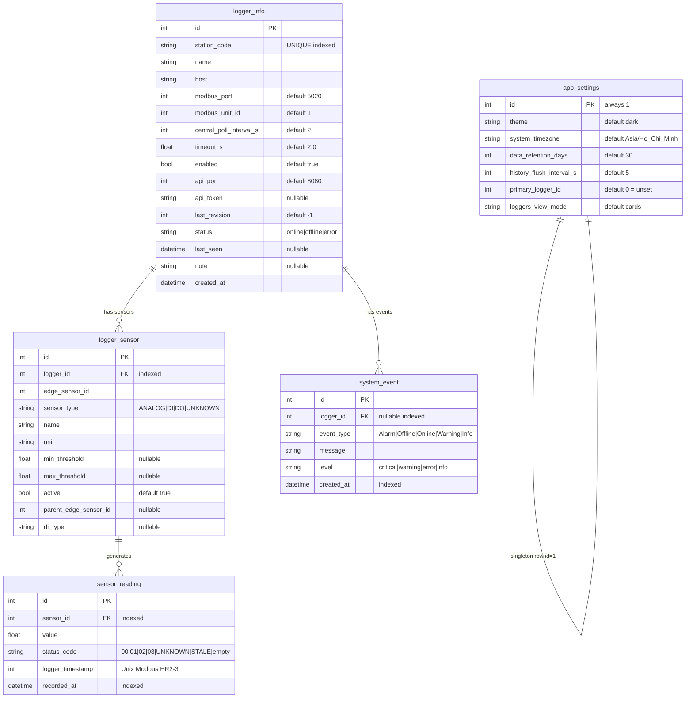
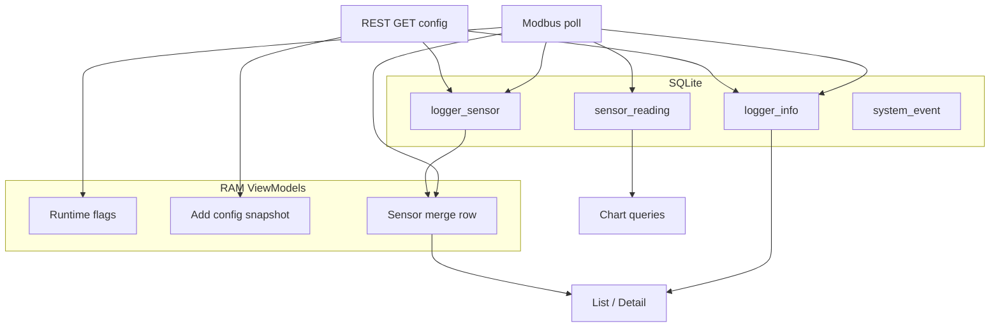

# Thiết kế cơ sở dữ liệu — Central Logger

**Ứng dụng:** Central Logger (Qt 6, C++/QML)  
**Lưu trữ:** SQLite trên máy người dùng  
**Stack C++:** `QSqlDatabase` + driver `QSQLITE` (`Qt6::Sql`) — xem [`adr/0001-db.md`](adr/0001-db.md)  
**Cập nhật:** 2026-11-21

> Cập nhật schema v8 (2026-11-18): thêm cột `app_settings.loggers_view_mode`
> (`'cards'` mặc định | `'list'`) lưu chế độ hiển thị của `Loggers > Data`;
> ngưỡng `logger_sensor.min_threshold/max_threshold` là bản mirror từ thiết bị
> (`GET /api/v1/config`), chỉ xem trong Central. Central không ghi cấu hình
> lên thiết bị; schema không đổi. Cờ cảnh báo lấy từ bit alarm của thiết bị (`qualityAlarm` / Modbus),
> độc lập với mã trạng thái TT10 (`sensor_reading.status_code`).
> Xem [`contracts/modbus-map-v2.md`](contracts/modbus-map-v2.md) và
> [`contracts/rest-config-contract-v1.md`](contracts/rest-config-contract-v1.md).

---

## Tổng quan

Central Logger quản lý nhiều **Data Logger** (Modbus TCP + REST). Dữ liệu được chia hai tầng:

| Tầng | Vai trò |
|------|---------|
| **SQLite** | Cấu hình trạm, catalog cảm biến, lịch sử đo, sự kiện, cài đặt app |
| **RAM** | Trạng thái realtime (poll Modbus), form cấu hình tạm (REST), merge hiển thị bảng sensor |

**Đường dẫn DB mặc định:** `~/.central-logger/central-logger.db` (có thể override bằng cấu hình app).

---

## Quy ước thiết kế

| Chủ đề | Quyết định |
|--------|------------|
| API truy cập DB | **`QSqlDatabase` / `QSQLITE`** — repositories qua `QSqlQuery`; test `:memory:` |
| Định danh trạm | `logger_info.station_code` — **UNIQUE**, indexed |
| REST endpoint | `http://{host}:{api_port}/api/v1` — **không** có cột `api_base_url` |
| Catalog cảm biến | Bảng `logger_sensor` — lưu tên, loại, đơn vị, ngưỡng |
| Time-series | `sensor_reading` → FK `logger_sensor.id` (không trỏ thẳng `logger_id`) |
| Auto-create sensor | Modbus poll gặp `edge_sensor_id` mới → INSERT `logger_sensor` với `sensor_type=UNKNOWN`; `GET /config` cập nhật metadata (`sensor_type`, tên, ngưỡng) |
| Live values | **Chỉ Modbus** — FC03 + FC02 + FC01; `GET /readings` chỉ **debug** (JSON gốc, không cập nhật bảng) |
| Trạng thái trạm trên đĩa | `logger_info.status`, `last_seen` — hiển thị/filter khi mở app, chart khi offline |
| Cấu hình edge | Chỉ tạm giữ thông tin Add trước Save; chỉ lưu catalog và revision, không có bảng riêng chứa toàn bộ cấu hình thiết bị |
| Retention | Chỉ xóa `sensor_reading` theo `data_retention_days`; **giữ** `logger_sensor` |

---

## 1. Sơ đồ ERD



### Ràng buộc và index

| Bảng | Ràng buộc |
|------|-----------|
| `logger_info` | `UNIQUE(station_code)`; index `(status)`, `(last_seen)` |
| `logger_sensor` | `UNIQUE(logger_id, sensor_type, edge_sensor_id)`; index `(logger_id)` |
| `sensor_reading` | index `(sensor_id, recorded_at)`; index `(recorded_at)` cho biểu đồ 24h |
| `system_event` | index `(logger_id, created_at)` |
| `app_settings` | một dòng duy nhất `id = 1` |

---

## 2. Chi tiết bảng

### `logger_info`

Cấu hình trạm và kết nối từ Central tới edge.

| Cột | Kiểu | Mặc định | Mô tả |
|-----|------|----------|--------|
| `id` | INTEGER PK | auto | |
| `station_code` | TEXT NOT NULL | — | Mã trạm (QR, REST, hoặc nhập tay) |
| `name` | TEXT NOT NULL | — | Tên hiển thị trên Central |
| `host` | TEXT NOT NULL | — | IP hoặc hostname |
| `modbus_port` | INTEGER | 5020 | Cổng Modbus TCP (Central poll) |
| `modbus_unit_id` | INTEGER | 1 | Unit ID phía client Central |
| `central_poll_interval_s` | INTEGER | 2 | Chu kỳ poll Central (giây) |
| `timeout_s` | REAL | 2.0 | Timeout TCP Modbus |
| `enabled` | BOOL | 1 | Bật/tắt poll |
| `api_port` | INTEGER | 8080 | Cổng REST API |
| `api_token` | TEXT | NULL | Bearer token |
| `last_revision` | INTEGER | -1 | Revision của bản sao gần nhất đọc từ `GET /config` |
| `status` | TEXT | `offline` | `online` \| `offline` \| `error` |
| `last_seen` | DATETIME | NULL | Lần giao tiếp thành công gần nhất (UTC) |
| `note` | TEXT | NULL | Ghi chú |
| `created_at` | DATETIME | now UTC | |

Cấu hình edge mở rộng (Buzzer, FTP, Serial, …) không lưu ở đây — xem mục 3.2 (RAM).

---

### `logger_sensor`

Catalog cảm biến trên đĩa: biểu đồ và ngưỡng vẫn dùng được khi trạm tạm mất kết nối (đọc lịch sử `sensor_reading` + metadata).

| Cột | Kiểu | Mặc định | Mô tả |
|-----|------|----------|--------|
| `id` | INTEGER PK | auto | Khóa nội bộ Central |
| `logger_id` | INTEGER FK | — | → `logger_info.id` |
| `edge_sensor_id` | INTEGER | — | ID sensor trên data logger |
| `sensor_type` | TEXT | `UNKNOWN` | `ANALOG` \| `DI` \| `DO` \| `UNKNOWN` |
| `name` | TEXT | — | Tên hiển thị |
| `unit` | TEXT | — | Đơn vị đo |
| `min_threshold` | REAL | NULL | Bản sao ngưỡng min từ thiết bị (`GET /config`; không đặt cục bộ) |
| `max_threshold` | REAL | NULL | Bản sao ngưỡng max từ thiết bị (`GET /config`; không đặt cục bộ) |
| `active` | BOOL | 1 | Bật/tắt trên trạm |
| `parent_edge_sensor_id` | INTEGER | NULL | Edge `id` analog cha (từ REST `parent_id`); NULL = top-level |
| `di_type` | TEXT | NULL | Mã attach-DI / báo cáo (`00`–`03`, custom); chủ yếu cho `sensor_type=DI` |

**Tạo bản ghi khi Modbus poll (pseudo):**

```
ON modbus_snapshot(logger_id, edge_sensor_id, value, ...):
  IF NOT EXISTS (logger_id, edge_sensor_id):
    INSERT logger_sensor(..., sensor_type='UNKNOWN', name='', unit='', active=1)
  INSERT sensor_reading(sensor_id, ...)
  UPDATE logger_info SET status='online', last_seen=now() WHERE id=logger_id
```

**Cập nhật metadata từ REST:** Add hoặc Reload dùng `GET /config` — cập nhật
`name`, `sensor_type`, `unit`, ngưỡng, `active`, `parent_edge_sensor_id`, `di_type`.
Nếu nguồn bỏ khóa ngưỡng, giữ giá trị đã biết; nếu gửi `null`, xóa giới hạn trong
bản sao. Không dùng `/readings` cho live.

---

### `sensor_reading`

Chỉ lưu giá trị theo thời gian; metadata nằm ở `logger_sensor`.

| Cột | Kiểu | Mô tả |
|-----|------|--------|
| `id` | INTEGER PK | |
| `sensor_id` | INTEGER FK | → `logger_sensor.id` |
| `value` | REAL | ANALOG: float từ FC03; DI/DO: **0.0** hoặc **1.0** chuẩn hóa từ bit FC02/FC01 |
| `status_code` | TEXT | Mã trạng thái; v1 không có TT10 chính xác nên dùng `UNKNOWN` |
| `logger_timestamp` | INTEGER | Unix từ HR2–HR3 |
| `recorded_at` | DATETIME | Thời điểm ghi (UTC) |

**Retention:** `DELETE FROM sensor_reading WHERE recorded_at < :cutoff` theo `app_settings.data_retention_days`.

**Truy vấn theo trạm:**

```sql
SELECT r.*
FROM sensor_reading r
JOIN logger_sensor s ON r.sensor_id = s.id
WHERE s.logger_id = :logger_id
  AND r.recorded_at >= :since;
```

---

### `system_event`

| Cột | Kiểu | Mô tả |
|-----|------|--------|
| `id` | INTEGER PK | |
| `logger_id` | INTEGER FK NULL | NULL = sự kiện toàn app |
| `event_type` | TEXT | Alarm, Offline, Online, Warning, Info |
| `message` | TEXT | |
| `level` | TEXT | critical, warning, error, info |
| `created_at` | DATETIME | |

Tên trạm khi hiển thị: `JOIN logger_info` (không lưu `logger_name` trùng lặp).

---

### `app_settings`

Cấu hình toàn cục — luôn một dòng `id = 1`.

| Cột | Mặc định |
|-----|----------|
| `theme` | `dark` |
| `system_timezone` | `Asia/Ho_Chi_Minh` |
| `data_retention_days` | `30` |
| `history_flush_interval_s` | `5` |
| `primary_logger_id` | `0` (chưa chọn — biểu đồ Graph fallback logger online đầu tiên) |
| `loggers_view_mode` | `cards` (`cards` \| `list` — chế độ hiển thị tab `Loggers > Data`) |

---

## 3. Dữ liệu trên RAM

Không ghi SQLite. Quản lý qua ViewModel C++ (`LoggerListModel`, `LoggerLiveCardsModel`, `LoggerLiveListModel`, `LoggerOverviewTableModel`, `LoggerFormController`, `ThresholdController`).

### 3.1 Runtime trạm (Modbus)

| Thuộc tính | Nguồn | UI |
|------------|--------|-----|
| `online` | TCP/Modbus | Icon trạng thái |
| `polling` | Modbus HR1 bit0 | Badge đang poll |
| `rtuConnected` | Modbus HR1 bit1 | RTU RS485 |
| `anyAlarm` | Modbus HR1 bit2 | Cảnh báo cấp trạm |
| `sensorCount` | Modbus HR4 / catalog | Overview |
| `lastUpdate` | Thời điểm poll OK | “Cập nhật X giây trước” |
| `lastError` | Lỗi TCP/Modbus | Debug |
| `statusText` | Logic từ `online` + `lastError` | Text tóm tắt |

`ModbusBridge` đồng bộ `logger_info.status` và `last_seen` khi poll thành công hoặc thất bại; các cờ bit ưu tiên trên RAM cho UI mượt.

### 3.2 Kết nối Central và bản sao cấu hình thiết bị

- **Add:** `Connect & Load Config` đọc `GET /api/v1/config`. Giữ station code,
  tên trạm, Modbus unit ID, catalog và revision trong RAM. Có thể dùng tên trạm
  làm gợi ý tên hiển thị; `poll_interval` của edge không đặt `central_poll_interval_s`.
  Save lưu bản ghi Central và catalog/revision đã đọc trong một transaction.
- **Edit:** form tải từ `logger_info` và lưu cài đặt Central, không cần REST.
- **Reload config:** dùng kết nối đã lưu để GET; commit catalog và `last_revision`
  cùng nhau, không đổi cài đặt Central. Lỗi không làm mất bản sao hiện có.

Hợp đồng API: [`docs/contracts/rest-config-contract-v1.md`](../docs/contracts/rest-config-contract-v1.md)

### 3.3 Sensor realtime (merge)

Merge `logger_sensor` (DB catalog) + snapshot Modbus hiện tại (RAM): FC03 analog + FC02 DI + FC01 DO — cùng nhịp poll.
Nếu poll thất bại hoặc cảm biến mất tín hiệu hợp lệ, Central giữ metadata nhưng ẩn giá trị cũ (`—`, `valid = false`); poll thành công tiếp theo cập nhật lại card/bảng.

| Thuộc tính | Nguồn | UI |
|------------|--------|-----|
| `current_value` | Modbus FC03 / FC02 / FC01 | Giá trị trên card/bảng (DI/DO: bit → ON/OFF; mất kết nối → `—`) |
| `display_status` | Mã trạng thái TT10 từ Modbus (`00`/`01`/`02`/`03`/`UNKNOWN`) | Chip trạng thái vận hành (độc lập với cảnh báo ngưỡng) |
| `attach_di_codes` | Catalog child DI + FC02 | Nhãn DI phụ đính kèm (`Error`, `Maintenance`, custom…) |
| `alarm_type` | Bit alarm của thiết bị (`qualityAlarm`) + ngưỡng mirror giải thích hướng | `min`, `max`, `min+max`, `device` — badge cảnh báo phụ (không tự kích hoạt nếu bit alarm của edge tắt) |
| `timestamp` | Modbus (`measuredAt`) | HH:MM:SS |

### 3.4 Loggers > Graph và export CSV trung bình

- **Graph:** mặc định theo primary logger (`app_settings.primary_logger_id`, `0` = tự chọn logger online đầu tiên). Chỉ vẽ analog. Cửa sổ mặc định 5 phút, zoom 1 phút–7 ngày. Dùng `PollHistoryStore` (tối đa 6 giờ và 4.000 mẫu/sensor); khi RAM không phủ toàn khoảng, ghép với truy vấn SQLite nền đã giảm mẫu theo min/max.
- **Other loggers** (`LoggerOverviewTableModel`): một hàng mỗi logger ngoài logger đang xem; cột analog theo bộ `(edge_sensor_id, tên, đơn vị)` từ `SensorSnapshotCache`. ID giống nhau nhưng tên hoặc đơn vị khác được tách cột để tránh gán sai nhãn.
- **History export** (`AverageExportService`): CSV theo giờ + dòng trung bình 24h, chỉ tính `status_code = '00'`; chạy nền bằng connection SQLite riêng. Schema không lưu bit alarm theo mẫu; graph không suy diễn alarm lịch sử từ ngưỡng hiện tại.

---

## 4. Luồng dữ liệu



---

## 5. Khởi tạo và nâng cấp database

### DB mới

Lần chạy app đầu tiên (file DB chưa tồn tại):

1. Tạo file SQLite tại đường dẫn cấu hình (`~/.central-logger/central-logger.db`)
2. Thực thi [`src/data/db/schema/001_initial.sql`](../src/data/db/schema/001_initial.sql) — `CREATE TABLE`, index, seed `app_settings` (`id=1`)
3. Gán `PRAGMA user_version = <kSchemaVersion>` (version hiện tại — xem `Database.cpp`)

### DB đã tồn tại

[`Database::open()`](../src/data/db/Database.cpp) đọc `PRAGMA user_version`:

| user_version | Hành xử |
|--------------|---------|
| `= kSchemaVersion` | mở bình thường (không backup) |
| `< kSchemaVersion` | **backup + tạo mới** (không migrate tại chỗ) |
| `> kSchemaVersion` | fail open → `FatalStartup.qml` |

**Chính sách pre-production:** repo chưa đưa lên production nên **không** có migration script tại chỗ. DB cũ hơn version app được `wal_checkpoint` + **move** thành `{path}.bak` (ghi đè bản cũ) rồi tạo lại **trống** từ `001_initial.sql` — dữ liệu cũ **không** được giữ lại (chỉ nằm trong `.bak` cho tham khảo). Điều này thay thế hoàn toàn cơ chế migration v2–v5 cũ (các file `00N_*.sql` đã xóa).

**DB mới hơn app:** app hiện [`FatalStartup.qml`](../src/app/qml/FatalStartup.qml) + [`AlertDialog`](../src/components/layout/AlertDialog.qml), thoát khi user đóng dialog.

### Đổi schema

1. Cập nhật `001_initial.sql` (schema đích cho DB mới).
2. Tăng `kSchemaVersion` trong `Database.cpp`.
3. Thêm test trong [`tests/data/test_database_migrations.cpp`](../tests/data/test_database_migrations.cpp) (fresh / older-backed-up / current-kept / newer-fails).
4. Cập nhật doc này.

> Khi lên production (có dữ liệu cần giữ), hãy đưa lại cơ chế migration có kiểm soát (schema_version + script `00N_*.sql`) thay vì recreate.

**Checklist release:** bump version, test DB phiên bản cũ được backup + tạo mới, cập nhật doc này.

---

## 6. Ánh xạ lớp C++

| Lớp | Trách nhiệm |
|-----|-------------|
| `Database` | `QSqlDatabase` (`QSQLITE`, `Qt6::Sql`): DB mới/old < version → `001_initial.sql` (old: backup `.bak` trước, không giữ data); DB ≥ version → mở; DB > version → `FatalStartup.qml` |
| `LoggerRepository` | CRUD `logger_info`, `status`, `last_seen` |
| `SensorCatalogRepository` | CRUD `logger_sensor`, auto-create, upsert REST |
| `SensorReadingRepository` | Batch insert readings, purge retention |
| `EventRepository` | `system_event` |
| `ModbusBridge` | Poll → catalog + readings + cập nhật `logger_info` |
| `SensorMerger` / `SensorSnapshotCache` | Catalog DB + Modbus snapshot → `LoggerLiveCardsModel` / `LoggerLiveListModel` (không REST live) |
| `LoggerFormController` / `ThresholdController` | Probe Add và Reload bằng GET, lưu cài đặt Central, và hiển thị ngưỡng đã lưu mà không gọi REST |

Cấu trúc mã đề xuất: `src/data/`, `src/core/`, `src/viewmodels/` (chi tiết khi scaffold CMake).

---
